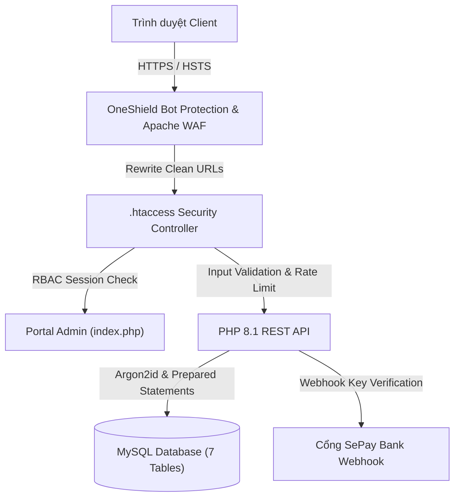

# Sân Bóng Pro — Hệ Thống Quản Lý & Đặt Sân Bóng Đá Trực Tuyến

> **Hệ thống đặt sân bóng đá tự động, chuẩn hóa giao diện trực quan chuẩn FIFA, tích hợp thanh toán VietQR SePay 1 chạm và phân hệ quản trị vận hành toàn diện.**

* **Domain chính thức (Production Live):** [https://fxzioyr.id.vn](https://fxzioyr.id.vn)
* **Kho lưu trữ GitHub:** [github.com/vinhce/Web_Quan_Ly_San_Bong](https://github.com/vinhce/Web_Quan_Ly_San_Bong)
* **Trạng thái Go-Live:** **SẴN SÀNG VẬN HÀNH THẬT 100% (PRODUCTION READY - QA PASS)**
* **Cập nhật:** 09/11/2026 (Phiên bản Go-Live chính thức)

---

## Thông Tin Cơ Sở & Liên Hệ

* **Địa chỉ cơ sở:** Khu liên hợp Thể thao Pro, Số 18 Đường Lê Đức Thọ, Phường Mỹ Đình, Quận Nam Từ Liêm, TP. Hà Nội.
* **Hotline hỗ trợ 24/7:** **[0352 313 548](tel:0352313548)**
* **Hỗ trợ qua Zalo:** **[zalo.me/0352313548](https://zalo.me/0352313548)**
* **Giờ mở cửa:** 05:30 – 23:00 (Tất cả các ngày trong tuần)
* **Tài khoản thụ hưởng VietQR (SePay):**
  * **Ngân hàng:** MB Bank (Ngân hàng Quân Đội)
  * **Số tài khoản:** `0352313548`
  * **Chủ tài khoản:** `DO THANH LONG`
  * **Chính sách đặt cọc:** Thanh toán cọc 30% qua VietQR để giữ chỗ tức thì; 70% còn lại thanh toán tại quầy khi nhận sân.

---

## Tính Năng Nổi Bật

### 1. Dành cho Khách hàng (Customer Experience)
- **Xem & Tìm sân trực quan:** Phân loại sân 5, sân 7, sân 11 người chuẩn FIFA; hiển thị tình trạng mặt cỏ, kích thước và biểu đồ giá linh hoạt.
- **Dự báo thời tiết sân bóng:** Tích hợp Open-Meteo API lấy dữ liệu nhiệt độ, thời tiết thực tế tại sân Mỹ Đình theo thời gian thực.
- **Ma trận đặt slot giờ thông minh:** Hiển thị trực quan các slot (Trống, Đang đá, Đã đặt), chống đặt trùng giờ. Hạn chế đặt lùi ngày trong quá khứ.
- **Thanh toán VietQR tự động qua SePay:** Sinh mã VietQR động theo chuẩn ngân hàng, đối soát và tự động duyệt đơn ngay khi có biến động số dư.
- **Mã đơn chuẩn hóa:** Định dạng mã đơn tiện ích theo chuẩn ngân hàng (`ASFF` Sân 5, `ASFS` Sân 7, `ASFE` Sân 11).
- **Vé điện tử & QR Check-in:** Phát hành vé check-in ngay sau khi cọc, hỗ trợ in vé PDF và chỉ đường Google Maps đến sân.
- **Hệ thống hội viên & Voucher:** Quản lý lịch sử đặt sân, tích điểm theo chi tiêu và phân hạng thành viên (Đồng, Bạc, Vàng, Kim Cương) kèm mã giảm giá 1 chạm.
- **Widget liên hệ nổi (Floating Widget):** Tích hợp nút gọi Hotline và Chat Zalo trực tiếp ở góc màn hình trên mọi trang.

### 2. Phân hệ Quản trị Vận hành (Portal Admin)
- **Tab 1 - Tổng quan KPI:** Doanh thu hôm nay, tỷ lệ lấp đầy sân, số ca đá đã đặt, cảnh báo bảo trì.
- **Tab 2 - Lịch đặt sân Timeline Gantt:** Biểu đồ thời gian trực quan theo từng sân bóng từ 05:30 đến 23:00.
- **Tab 3 - Đặt sân nhanh tại quầy:** Hỗ trợ lễ tân tạo đơn nhanh cho khách vãng lai, áp dụng chiết khấu trực tiếp.
- **Tab 4 - Quản lý sân bóng:** Thêm, sửa thông tin, bật/tắt chế độ bảo trì sân tức thì.
- **Tab 5 - Bảng giá & Giờ cao điểm:** Cấu hình khung giá ngày thường, giờ cao điểm và ngày cuối tuần.
- **Tab 6 - Khách & Hội viên CRM:** Theo dõi danh sách khách hàng, tổng chi tiêu, lịch sử ca đá và thứ hạng tích điểm.
- **Tab 7 - Duyệt cọc VietQR 1 chạm:** Quản lý biên lai chuyển khoản ngân hàng, duyệt/từ chối cọc tức thì kèm đồng bộ số lượng.
- **Tab 8 - Báo cáo doanh thu chuyên sâu:** Biểu đồ doanh thu theo ngày/tháng, phân tích loại sân sinh lời cao nhất, xuất file Excel CSV.
- **Tab 9 - Cài đặt hệ thống:** Tùy chỉnh hotline, tỷ lệ cọc bắt buộc, giờ mở cửa và thông tin tài khoản VietQR.

---

## Kiến Trúc Bảo Mật & Hạ Tầng (OWASP Web Security Standard)

Hệ thống tuân thủ nghiêm ngặt chuẩn an toàn thông tin ứng dụng web theo đặc tả `security-web.md`:



1. **Xác thực & Mã hóa:** Mật khẩu lưu trữ băm bằng thuật toán **Argon2id** (`PASSWORD_ARGON2ID`). Không lưu mật khẩu dạng plaintext.
2. **Kiểm soát phiên làm việc (Session RBAC):** Cookie phiên gắn đủ 3 cờ `HttpOnly`, `Secure`, `SameSite=Lax`. Hết hạn phiên 2 giờ (7200s), tự động hủy và đổi `session_id` khi đăng nhập.
3. **Bảo vệ cổng Quản trị:** Phân hệ `/portal-admin/` kiểm tra quyền `role === 'admin'` ở tầng máy chủ PHP; người dùng chưa đăng nhập bị chuyển hướng 302 về trang đăng nhập.
4. **Phòng chống tấn công:**
   - **Chống SQL Injection:** 100% câu lệnh qua PDO Prepared Statements với tham số hóa.
   - **Chống IDOR:** Kiểm tra quyền sở hữu đơn đặt sân ở máy chủ; khách vãng lai bị che mờ số điện thoại và email.
   - **Chống Brute Force:** Bộ lọc Rate Limiting chặn tạm 15 phút (`HTTP 429`) khi nhập sai quá 5 lần.
   - **Chống Sửa giá (Price Tampering):** Máy chủ tự tính toán lại toàn bộ chi phí theo bảng giá trong CSDL, không phụ thuộc vào dữ liệu gửi từ trình duyệt.
   - **Chống Giả mạo Webhook:** Webhook SePay bắt buộc xác thực `SEPAY_WEBHOOK_KEY` qua so sánh chuỗi an toàn `hash_equals` hoặc đối chiếu giao dịch gốc.
5. **Security Headers trên Trình duyệt:**
   - `Strict-Transport-Security: max-age=31536000; includeSubDomains; preload`
   - `Content-Security-Policy: default-src 'self' ...`
   - `X-Content-Type-Options: nosniff`
   - `X-Frame-Options: SAMEORIGIN`
   - `Referrer-Policy: strict-origin-when-cross-origin`
   - `Permissions-Policy: geolocation=(), camera=(), microphone=()`
6. **Bảo vệ tệp tin nhạy cảm:** Tệp cấu hình `.env` được đặt ngoài thư mục `public_html`. Tệp `.git`, `.json`, `.log`, `.bak`, `.sql` bị chặn truy cập trực tiếp bằng mã lỗi `403 Forbidden`.

---

## Cấu Trúc Mã Nguồn Chuẩn Hóa

```text
Web_Quan_Ly_San_Bong/
├── index.html                        # Trang chủ: Tìm kiếm nhanh, sân nổi bật, voucher, thời tiết
├── .htaccess                         # Điều hướng Clean URLs, ép HTTPS 301, chặn file nhạy cảm, nạp Header bảo mật
├── .env.example                      # Mẫu biến môi trường an toàn (Database, SePay API Token, Webhook Key)
├── robots.txt                        # Chỉ dẫn công cụ tìm kiếm, chặn bot quét API và Admin
├── css/                              # Thư mục giao diện tách module
│   ├── base.css                      # Reset style, font chữ Plus Jakarta Sans & Inter
│   ├── components.css                # Style UI Card, Button, Input, Modal, Badge
│   ├── booking.css                   # Style ma trận slot giờ và thanh tiến trình
│   ├── admin.css                     # Style biểu đồ Gantt timeline, bảng điều khiển KPI
│   └── print.css                     # Định dạng in vé check-in điện tử
├── js/                               # Thư mục mã nguồn logic JavaScript ES6
│   ├── helpers.js                    # Hàm tiện ích (định dạng tiền, vẽ SVG sân bóng FIFA, icon hệ thống)
│   ├── db.js                         # Bộ điều khiển dữ liệu SanBongDB (kết nối LocalStorage & API)
│   ├── ui.js                         # Thành phần UI dùng chung (Navbar, Footer, Floating Widget, Toast, Modal)
│   ├── app.js                        # Gói Bundle hợp nhất phục vụ môi trường Production
│   ├── api.js                        # Lớp gọi API bất đồng bộ (Fetch API, Open-Meteo, VietQR, SePay)
│   ├── index.js                      # Logic điều khiển trang chủ
│   ├── fields.js                     # Logic tìm kiếm, lọc loại sân, giá và tiện ích
│   ├── field-detail.js               # Logic trang chi tiết sân bóng
│   ├── booking.js                    # Logic đặt sân, chọn slot giờ, dịch vụ thêm và voucher
│   ├── checkout.js                   # Logic tạo mã VietQR động, đếm ngược giữ slot 10 phút, kiểm tra cọc
│   ├── success.js                    # Logic hiển thị vé QR, in vé và tải về
│   ├── history.js                    # Logic tra cứu đơn đặt sân và điểm thưởng hội viên
│   ├── admin.js                      # Toàn bộ logic 9 phân hệ quản trị viên
│   └── login.js                      # Logic xác thực đăng nhập, đăng ký và bảo vệ tài khoản
├── html/                             # Giao diện các trang chức năng (Clean URLs)
│   ├── fields.html                   # /fields: Danh sách và bộ lọc sân bóng
│   ├── field-detail.html             # /field-detail: Chi tiết sân bóng, cơ sở vật chất, bảng giá
│   ├── booking.html                  # /booking: Chọn ngày đá, slot giờ, dịch vụ và voucher
│   ├── checkout.html                 # /checkout: Quét mã VietQR chuyển khoản cọc 30%
│   ├── success.html                  # /success: Vé điện tử xác nhận đặt sân thành công
│   ├── history.html                  # /history: Tra cứu lịch sử ca đá & điểm hội viên
│   └── login.html                    # /login: Đăng nhập & Đăng ký tài khoản
├── portal-admin/                     # Phân hệ Quản trị viên (/portal-admin)
│   ├── index.php                     # Cổng kiểm tra quyền Session Admin (RBAC Gateway)
│   ├── index.html                    # Giao diện điều khiển trung tâm
│   └── partials/                     # 9 module quản trị phân tách độc lập (PHP Partials)
│       ├── header.php                # Header điều hướng và thanh tìm kiếm toàn cục
│       ├── sidebar.php               # Menu danh mục 9 phân hệ quản trị
│       ├── tab1_kpi.php              # Module tổng quan KPI & doanh thu
│       ├── tab2_timeline.php         # Module lịch đặt sân Timeline Gantt
│       ├── tab3_quick_booking.php    # Module đặt sân nhanh tại quầy
│       ├── tab4_pitches.php          # Module quản lý danh sách sân & bảo trì
│       ├── tab5_pricing.php          # Module cấu hình bảng giá & giờ cao điểm
│       ├── tab6_customers.php        # Module quản lý khách hàng & hội viên
│       ├── tab7_deposits.php         # Module duyệt biên lai cọc VietQR 1 chạm
│       ├── tab8_reports.php          # Module báo cáo phân tích doanh thu & xuất Excel
│       └── tab9_settings.php         # Module cài đặt hệ thống & ngân hàng VietQR
├── api/                              # Backend API RESTful chuẩn mực
│   ├── security_helper.php           # Thư viện bảo mật trung tâm (Rate limit, Session, CSRF, Sanitization)
│   ├── sepay_helper.php              # Thư viện kết nối SePay API v2 và đối soát giao dịch
│   ├── auth.php                      # Endpoint Đăng nhập, Đăng ký, Đăng xuất, Lấy phiên (Argon2id)
│   ├── bookings.php                  # Endpoint Tạo đơn, Chi tiết đơn, Chống IDOR, Hủy đơn
│   ├── pitches.php                   # Endpoint Lấy danh sách sân bóng & lịch thi đấu
│   ├── check_payment.php             # Endpoint Polling kiểm tra trạng thái cọc thời gian thực
│   └── sepay_webhook.php             # Endpoint tiếp nhận Webhook ngân hàng tự động
├── config/
│   └── database.php                  # Quản lý kết nối PDO MySQL và đọc biến môi trường .env an toàn
├── database/
│   └── schema.sql                    # Kịch bản khởi tạo 7 bảng CSDL MySQL và dữ liệu khởi tạo mẫu
├── logs/                             # Thư mục lưu vết bảo mật (Được bảo vệ 0750)
│   ├── php_errors.log                # Nhật ký lỗi máy chủ nội bộ
│   └── webhook_debug.log             # Nhật ký giao dịch webhook ngân hàng (đã che thông tin nhạy cảm)
└── scripts/                          # Bộ công cụ tự động hóa kiểm thử và triển khai
    ├── build_app_bundle.js           # Biên dịch tự động js/app.js từ các module con
    ├── bump_version.js               # Đánh phiên bản Cache-Busting cho toàn bộ file HTML
    ├── verify_all_local.js           # Bộ kiểm thử cú pháp và logic toàn diện (11 file JS)
    ├── run_production_pentest.js     # Script kiểm thử tấn công tự động trên Live Hosting
    └── deploy_all_to_hosting.js      # Script đồng bộ toàn bộ hệ thống lên Live Hosting qua MCP
```

---

## Hướng Dẫn Cài Đặt & Triển Khai

### 1. Triển khai Cục bộ (Local Development)
Yêu cầu: Laragon / XAMPP với PHP 8.1+ và MySQL.
1. Clone dự án vào thư mục webroot:
   ```bash
   cd C:/laragon/www
   git clone https://github.com/vinhce/Web_Quan_Ly_San_Bong.git
   cd Web_Quan_Ly_San_Bong
   ```
2. Tạo tệp `.env` từ tệp mẫu:
   ```bash
   cp .env.example .env
   ```
3. Cập nhật thông tin kết nối CSDL và tài khoản SePay vào tệp `.env`.
4. Nhập dữ liệu ban đầu vào MySQL:
   ```bash
   mysql -u root -p sanbongpro < database/schema.sql
   ```
5. Mở trình duyệt và truy cập: `http://localhost/Quan_Ly_San_Bong/`

### 2. Tài khoản Đăng nhập Hệ thống
| Vai trò | Tên đăng nhập (Username) | Mật khẩu mặc định | Quyền hạn |
| :--- | :--- | :--- | :--- |
| **Quản Trị Viên (Admin)** | `vxyen0801` | *Đã mã hóa Argon2id* | Toàn quyền quản trị vận hành (`/portal-admin/`) |
| **Khách Hàng (User)** | `0352313548` (hoặc `user`) | *Đã mã hóa Argon2id* | Đặt sân, xem lịch sử đơn, tích lũy điểm thưởng |

---

## Kiểm Thử & Nghiệm Thu Hệ Thống

Trước khi xuất bản hoặc triển khai các bản cập nhật mới, luôn chạy bộ công cụ kiểm thử tự động:

```bash
# 1. Kiểm thử cú pháp & tính toàn vẹn 11 file JavaScript:
node scripts/verify_all_local.js

# 2. Kiểm thử an toàn bảo mật nội bộ (Rate Limit, SQLi, IDOR, RBAC):
php scripts/security_penetration_test.php

# 3. Kiểm thử tấn công tự động trực tiếp trên máy chủ Production:
node scripts/run_production_pentest.js
```

---

## Giấy Phép & Bản Quyền

© 2026 **Sân Bóng Pro**. Bản quyền hệ thống thuộc về đơn vị quản lý và phát triển Sân Bóng Pro. Toàn bộ mã nguồn được xây dựng hướng tới hiệu năng cao, bảo mật tối ưu và khả năng mở rộng bền vững.
