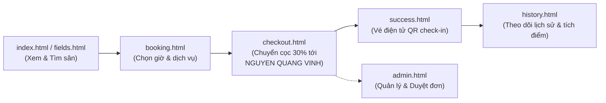

# Sân Bóng Pro – Hệ Thống Đặt Sân Bóng Đá Trực Tuyến

Hệ thống đặt sân bóng đá tự động, chuẩn hóa giao diện trực quan và trải nghiệm mượt mà. Dự án được xây dựng bằng kiến trúc Frontend thuần (Static Web), lưu trữ dữ liệu an toàn trên trình duyệt qua `LocalStorage`, giúp bất kỳ ai trong nhóm tải về đều có thể mở lên chạy và code tiếp được ngay mà không cần cài đặt môi trường phức tạp hay cơ sở dữ liệu nặng nề.

---

## 📍 Thông Tin Cơ Sở & Liên Hệ

* **Địa chỉ sân bóng:** Khu liên hợp Thể thao Pro, Số 18 Đường Lê Đức Thọ, Phường Mỹ Đình, Quận Nam Từ Liêm, TP. Hà Nội.
* **Hotline hỗ trợ 24/7:** **0352 313 548**
* **Giờ mở cửa:** 05:30 – 23:00 (Tất cả các ngày trong tuần)
* **Thông tin tài khoản nhận cọc:**
  * **Ngân hàng:** Vietcombank (VCB) – Chi nhánh Mỹ Đình, Hà Nội
  * **Số tài khoản:** `0123456789`
  * **Chủ tài khoản:** **NGUYEN QUANG VINH**
  * **Chính sách cọc:** Chuyển khoản cọc 30%, 70% còn lại thanh toán tại quầy khi nhận sân.

---

## 🚀 Hướng Dẫn Tải Về & Khởi Chạy (Dành Cho Thành Viên Nhóm)

### 1. Tải mã nguồn về máy
Mở Terminal / Git Bash / Command Prompt và chạy lệnh:
```bash
git clone https://github.com/vinhce/Web_Quan_Ly_San_Bong.git
cd Web_Quan_Ly_San_Bong
```

### 2. Khởi chạy ứng dụng
Không cần cài đặt `npm`, không cần `composer` hay cài đặt PHP/Node.js. Bạn có thể chạy theo một trong các cách sau:

* **Cách 1 (Khuyên dùng khi lập trình):** Mở thư mục dự án bằng **Visual Studio Code**, cài extension **Live Server** (Ritwick Dey), sau đó click chuột phải vào file `index.html` và chọn **Open with Live Server** (cổng mặc định `http://127.0.0.1:5500/index.html`).
* **Cách 2 (Mở trực tiếp):** Nhấp đúp chuột trực tiếp vào file `index.html` để mở trên trình duyệt bất kỳ (Google Chrome, Microsoft Edge, Firefox).
* **Cách 3 (Nếu dùng Laragon / XAMPP):** Đặt thư mục dự án vào thư mục `www` (Laragon) hoặc `htdocs` (XAMPP) và truy cập `http://localhost/Web_Quan_Ly_San_Bong/index.html`.

---

## 📁 Cấu Trúc Dự Án & Chức Năng Từng Trang

```text
Web_Quan_Ly_San_Bong/
├── index.html          # Trang chủ: Giới thiệu sân, banner tìm kiếm nhanh, sân nổi bật, voucher ưu đãi
├── fields.html         # Danh sách sân: Bộ lọc theo loại sân (5, 7, 11 người), mức giá, tiện ích đi kèm
├── booking.html        # Đặt sân: Chọn ngày, ma trận khung giờ trực quan, dịch vụ thêm (nước, áo, bóng, trọng tài), mã giảm giá
├── checkout.html       # Thanh toán cọc: Bảng thông tin chuyển khoản ngân hàng (Chủ TK: NGUYEN QUANG VINH), bộ đếm ngược 10 phút
├── success.html        # Đặt sân thành công: Vé điện tử check-in kèm mã QR check-in sân, in vé, lưu thông tin trận đấu
├── history.html        # Lịch sử & Hội viên: Danh sách trận đã đặt, hạng thành viên, điểm thưởng tích lũy (SĐT: 0352 313 548)
├── admin.html          # Quản trị Admin: Thống kê doanh thu, quản lý danh sách sân, duyệt & hủy lịch đặt sân
├── login.html          # Trang đăng nhập / xác thực hội viên
├── assets/
│   └── js/
│       ├── data.js     # Mock Database: Dữ liệu khởi tạo (sân bóng, khung giờ, dịch vụ, voucher, tài khoản ngân hàng)
│       └── app.js      # Core Logic: State LocalStorage (SanBongDB), tính tiền cọc, render Navbar/Footer, vector sân bóng SVG
├── .gitignore          # Cấu hình bỏ qua các tệp tạm, tệp nội bộ
└── README.md           # Tài liệu hướng dẫn sử dụng và phát triển
```

---

## 🔄 Luồng Nghiệp Vụ Hoạt Động (End-to-End Flow)



1. **Khách hàng duyệt sân:** Tìm kiếm theo loại sân (sân 5, sân 7, sân 11) và ngày thi đấu.
2. **Chọn khung giờ & dịch vụ:** Ma trận giờ trực quan tự động đánh dấu slot "Trống", "Đang đá" hoặc "Đã đặt". Tùy chọn mua nước, áo bib, thuê trọng tài và áp mã ưu đãi (ví dụ: `WELCOME10`, `GIAM50K`).
3. **Thanh toán cọc 30%:** Trang `checkout.html` hiển thị rõ ràng thông tin người nhận:
   * **Ngân hàng:** Vietcombank
   * **Chủ tài khoản:** NGUYEN QUANG VINH
   * **Số tài khoản:** 0123456789
   * Có nút sao chép `📋` nhanh cho Số tài khoản, Số tiền cọc và Nội dung chuyển khoản.
4. **Nhận vé check-in:** Chuyển sang `success.html` với mã đặt sân (SB-xxxx) và mã QR check-in tại quầy trước giờ thi đấu.
5. **Quản trị viên (Admin):** Theo dõi lịch đặt trong `admin.html`, lọc theo ngày, đổi trạng thái sân hoặc xác nhận cọc.

---

## 🛠️ Công Nghệ Sử Dụng

* **Giao diện (Frontend):** HTML5 Semantics, Tailwind CSS (qua CDN), Font Plus Jakarta Sans & Inter.
* **Vector Graphic:** Sơ đồ mặt cỏ sân bóng FIFA, vạch sân bóng, icon hệ thống vẽ hoàn toàn bằng SVG thuần (không lo vỡ hình, tải siêu tốc, không cần asset ảnh nặng).
* **Quản trị State & Dữ liệu:** Vanilla JavaScript (ES6+), tích hợp sẵn `SanBongDB` tự động khởi tạo và đồng bộ trạng thái qua `localStorage`.

---

## 💡 (Code Tiếp)

1. **Truy xuất và cập nhật dữ liệu:**
   Mọi trang đều nạp `assets/js/data.js` và `assets/js/app.js`. Bạn có thể tương tác với cơ sở dữ liệu mô phỏng qua đối tượng toàn cục `window.SanBongApp.SanBongDB`:
   ```javascript
   // Lấy danh sách sân
   const pitches = window.SanBongApp.SanBongDB.getPitches();

   // Lấy danh sách khung giờ kèm trạng thái theo ngày
   const slots = window.SanBongApp.SanBongDB.getSlots('P7-A', '2026-11-07');

   // Tạo đơn đặt sân mới
   const newBooking = window.SanBongApp.SanBongDB.createBooking({
     customerName: 'Tên khách',
     phone: '0352313548',
     pitchId: 'P7-A',
     date: '2026-11-07',
     slotId: 'S10',
     slotTime: '17:30 - 19:00',
     services: [],
     voucherCode: ''
   });
   ```

2. **Quy chuẩn giao diện:**
   * Màu chủ đạo hệ thống: Xanh lá sân cỏ `#16A34A` (Hover: `#15803D`).
   * Nền trang: `#F8FAFC`, Nền khối nội dung: `#FFFFFF`, Viền: `#E2E8F0`.
   * Màu chữ tiêu đề: `#0F172A`, Màu chữ phụ: `#64748B`.

3. **Lưu ý khi đẩy code lên Git:**
   * Hãy kéo code mới nhất về trước khi sửa: `git pull origin main`.
   * File `.gitignore` đã được cấu hình sẵn để loại trừ các file rác phát sinh.
