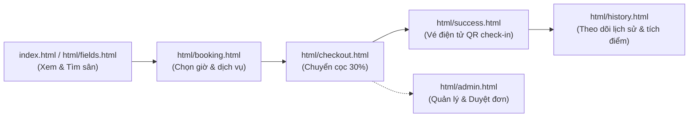

# Sân Bóng Pro – Hệ Thống Đặt Sân Bóng Đá Trực Tuyến

Hệ thống đặt sân bóng đá tự động, chuẩn hóa giao diện trực quan và trải nghiệm mượt mà. Dự án được xây dựng bằng kiến trúc Frontend thuần (Static Web) tách bạch rõ ràng theo các thư mục `css/`, `js/`, `html/`, `data/` và chỉ có tệp `index.html` ở thư mục gốc ngoài cùng. Dữ liệu được nạp bất đồng bộ qua **Fetch API** và lưu trữ bền vững trên trình duyệt qua `LocalStorage`, giúp bất kỳ ai trong nhóm tải về đều có thể mở lên chạy và code tiếp được ngay mà không cần cài đặt môi trường phức tạp hay cơ sở dữ liệu nặng nề.

---

## 📍 Thông Tin Cơ Sở & Liên Hệ

* **Địa chỉ sân bóng:** Khu liên hợp Thể thao Pro, Số 18 Đường Lê Đức Thọ, Phường Mỹ Đình, Quận Nam Từ Liêm, TP. Hà Nội.
* **Hotline hỗ trợ 24/7:** **0352 313 548**
* **Giờ mở cửa:** 05:30 – 23:00 (Tất cả các ngày trong tuần)
* **Thông tin tài khoản nhận cọc:**
  * **Chính sách cọc:** Chuyển khoản cọc 30%, 70% còn lại thanh toán tại quầy khi nhận sân.

---

## 🚀 Hướng Dẫn Tải Về & Khởi Chạy (Dành Cho Thành Viên Nhóm)

### 1. Tải mã nguồn về máy
Mở Terminal / Git Bash / Command Prompt và chạy lệnh:
```bash
git clone https://github.com/vinhce/Web_Quan_Ly_San_Bong.git
cd Web_Quan_Ly_San_Bong
```

### 2. Khởi chạy ứng dụng
Không cần cài đặt `npm`, không cần `composer` hay cài đặt PHP/Node.js:
- **Cách 1 (Nhanh nhất):** Nhấp đúp chuột trực tiếp vào tệp `index.html` ở thư mục ngoài cùng để mở trên trình duyệt (Chrome, Edge, Brave, Cốc Cốc, Firefox).
- **Cách 2 (Khuyến nghị cho Fetch API):** Chạy qua máy chủ tĩnh như Live Server (VS Code), Laragon (`http://localhost/Quan_Ly_San_Bong`), hoặc XAMPP.

---

## 📁 Cấu Trúc Thư Mục Chuẩn Hóa (Không Phình File)

Dự án đã được phân tách gọn gàng, loại bỏ hoàn toàn các đoạn mã inline cồng kềnh:

```text
Web_Quan_Ly_San_Bong/
├── index.html          # Trang chủ ngoài cùng: Giới thiệu, banner tìm kiếm nhanh, sân nổi bật, voucher
├── data/
│   └── data.json       # Cơ sở dữ liệu JSON cho Fetch API (6 sân bóng, slot giờ, dịch vụ, voucher)
├── css/
│   ├── base.css        # Reset, typography, font chữ Inter & Plus Jakarta Sans
│   ├── components.css  # Thẻ UI Card, nút bấm (primary/secondary/danger/sm), ô input
│   ├── booking.css     # Style cho slot chips khung giờ thi đấu
│   ├── admin.css       # Style cho phân hệ quản trị, timeline Gantt, sọc chéo bảo trì
│   ├── print.css       # Định dạng khi bấm in vé check-in điện tử
│   └── style.css       # Master stylesheet nạp và điều phối các module CSS trên
├── js/
│   ├── api.js          # API & Fetch Service: Quản lý fetch() tải JSON, thời tiết sân bóng, ngân hàng
│   ├── data.js         # Mock Database: Dữ liệu khởi tạo (6 sân bóng, slot giờ, dịch vụ, voucher, tài khoản NH)
│   ├── app.js          # Core Engine: State LocalStorage (SanBongDB), Navbar/Footer dùng chung, render SVG sân bóng
│   ├── index.js        # Logic riêng trang chủ index.html (Fetch thời tiết & sân bóng)
│   ├── fields.js       # Logic danh sách & bộ lọc sân bóng (Fetch dữ liệu sân)
│   ├── booking.js      # Logic đặt sân, chọn slot giờ, dịch vụ & áp voucher
│   ├── checkout.js     # Logic thanh toán cọc ngân hàng & Fetch POST đặt sân
│   ├── success.js      # Logic vé điện tử & QR check-in
│   ├── history.js      # Logic lịch sử đặt sân, hủy sân & điểm thưởng hội viên
│   ├── admin.js        # Logic 9 phân hệ quản trị viên (KPI, Gantt, bật/tắt bảo trì sân, duyệt cọc)
│   └── login.js        # Logic đăng nhập, đăng ký tài khoản hội viên
├── html/
│   ├── fields.html     # Danh sách sân: Bộ lọc theo loại sân (5, 7, 11 người), khoảng giá, tiện ích
│   ├── booking.html    # Đặt sân: Chọn ngày, ma trận khung giờ trực quan, dịch vụ thêm, mã giảm giá
│   ├── checkout.html   # Thanh toán cọc 30%: Thông tin chuyển khoản MB Bank
│   ├── success.html    # Đặt sân thành công: Vé điện tử kèm mã QR check-in sân, chức năng in vé
│   ├── history.html    # Lịch sử đặt sân & Hội viên: Danh sách trận đã đặt, hạng thành viên (SĐT: 0352 313 548)
│   ├── admin.html      # Quản trị Admin: 9 module vận hành, timeline Gantt, tạo đơn tại quầy, duyệt cọc
│   └── login.html      # Trang đăng nhập / đăng ký hội viên
├── .gitignore          # Cấu hình bỏ qua các tệp tạm
└── README.md           # Tài liệu hướng dẫn sử dụng và phát triển
```

---

## 🔄 Luồng Nghiệp Vụ Hoạt Động (End-to-End Flow)



1. **Khách hàng duyệt sân:** Tìm kiếm theo loại sân (sân 5, sân 7, sân 11) và ngày thi đấu. Dữ liệu sân nạp bất đồng bộ qua `fetch()`.
2. **Chọn khung giờ & dịch vụ:** Ma trận giờ trực quan tự động đánh dấu slot "Trống", "Đang đá" hoặc "Đã đặt". Tùy chọn mua nước, áo bib, thuê trọng tài và áp mã ưu đãi (ví dụ: `WELCOME10`, `GIAM50K`).
3. **Thanh toán cọc 30%:** Trang `checkout.html` hiển thị mã QR và thông tin chuyển khoản Vietcombank.
4. **Xác nhận qua Fetch POST:** Khi bấm xác nhận, hệ thống gọi `fetch()` gửi payload đơn đặt sân lên API endpoint.
5. **Nhận vé check-in:** Chuyển sang `success.html` với mã đặt sân chuẩn SePay (`ASFF` Sân 5, `ASFS` Sân 7, `ASFE` Sân 11) và mã QR check-in tại quầy trước giờ thi đấu.
6. **Quản trị viên (Admin):** Theo dõi lịch đặt trong `admin.html`, lọc theo ngày, đổi trạng thái sân hoặc xác nhận cọc.

---

## 🛠️ Công Nghệ Sử Dụng

* **Giao diện (Frontend):** HTML5 Semantics, Tailwind CSS (qua CDN), Font Plus Jakarta Sans & Inter.
* **Tách Module CSS:** `css/base.css`, `css/components.css`, `css/booking.css`, `css/admin.css`, `css/print.css`.
* **Giao thức Fetch API (async/await):**
  * Fetch dữ liệu sân bóng từ tệp `data/data.json`.
  * Fetch thời tiết thực tế tại sân Mỹ Đình từ Open-Meteo API (`https://api.open-meteo.com/v1/forecast`).
  * Fetch danh sách ngân hàng hợp lệ từ VietQR Open API (`https://api.vietqr.io/v2/banks`).
  * Fetch POST gửi dữ liệu đơn đặt sân.
* **Vector Graphic:** Sơ đồ mặt cỏ sân bóng FIFA, vạch sân bóng, icon hệ thống vẽ hoàn toàn bằng SVG thuần (không lo vỡ hình, tải siêu tốc, không cần asset ảnh nặng).
* **Quản trị State & Dữ liệu:** Vanilla JavaScript (ES6+), tích hợp sẵn `SanBongDB` tự động khởi tạo và đồng bộ trạng thái qua `localStorage`.

---

## 💡 Hướng Dẫn Dành Cho Thành Viên Nhóm (Code Tiếp)

1. **Sử dụng Fetch API (`js/api.js`):**
   Bạn có thể gọi các hàm bất đồng bộ qua `window.SanBongApp.SanBongAPI`:
   ```javascript
   // 1. Tải danh sách sân bằng Fetch API:
   const pitches = await window.SanBongApp.SanBongAPI.getPitches();

   // 2. Tải thời tiết sân bóng hiện tại bằng Fetch API:
   const weather = await window.SanBongApp.SanBongAPI.fetchWeather();
   console.log(weather.temperature, weather.condition);

   // 3. Gửi đơn đặt sân qua Fetch POST:
   await window.SanBongApp.SanBongAPI.postBooking(newBookingData);
   ```

2. **Truy xuất cơ sở dữ liệu nội bộ (`SanBongDB`):**
   ```javascript
   const slots = window.SanBongApp.SanBongDB.getSlotsWithStatus('P7-A', '2026-11-08');
   ```

3. **Quy tắc điều hướng (Smart Link Routing):**
   - Hàm `window.SanBongApp.getRelativePath(target)` trong `js/app.js` tự động tính đường dẫn tương đối tùy thuộc vào vị trí người dùng đang ở root (`index.html`) hay trong thư mục con (`html/*.html`).
   - Các trang bên trong `html/` khi liên kết với nhau chỉ cần gọi trực tiếp tên tệp (ví dụ: `href="booking.html"`) và quay về trang chủ bằng `href="../index.html"`.
